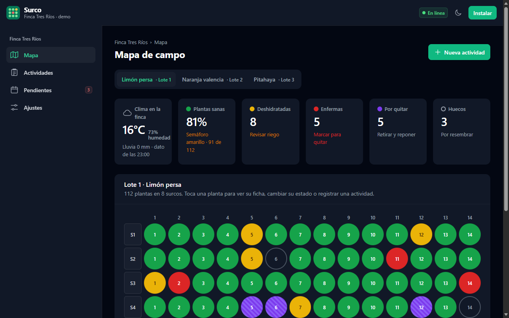
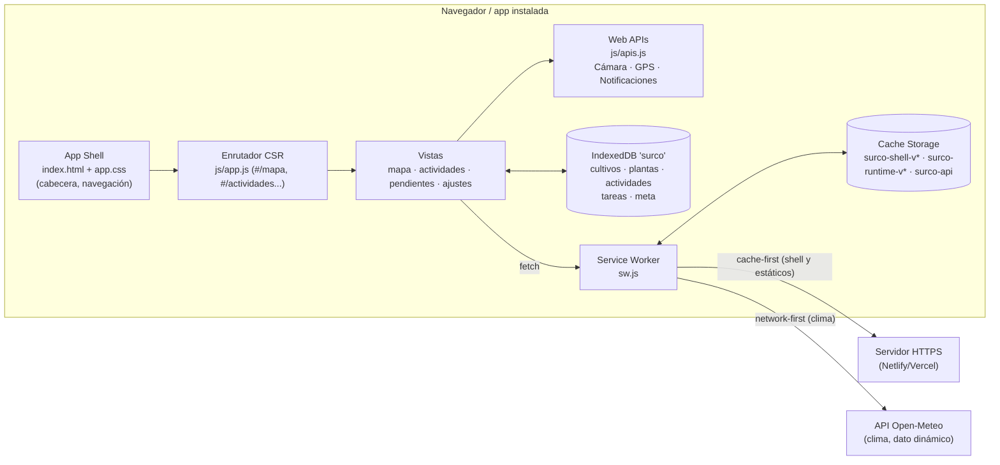
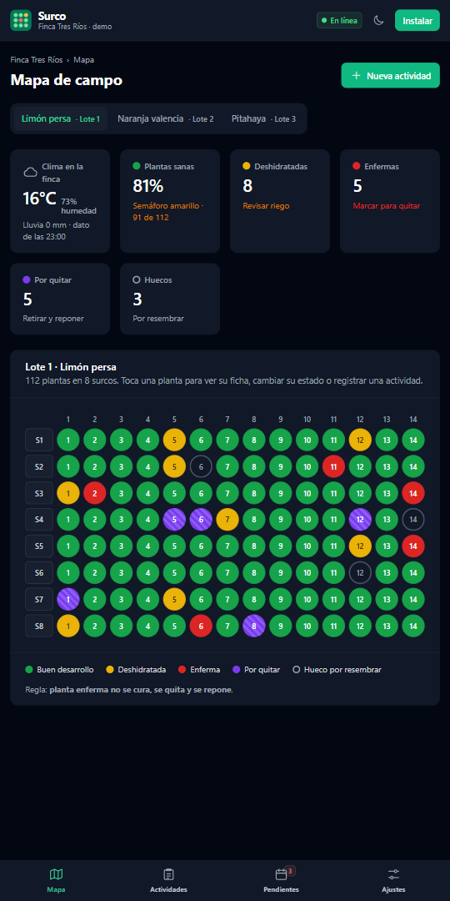
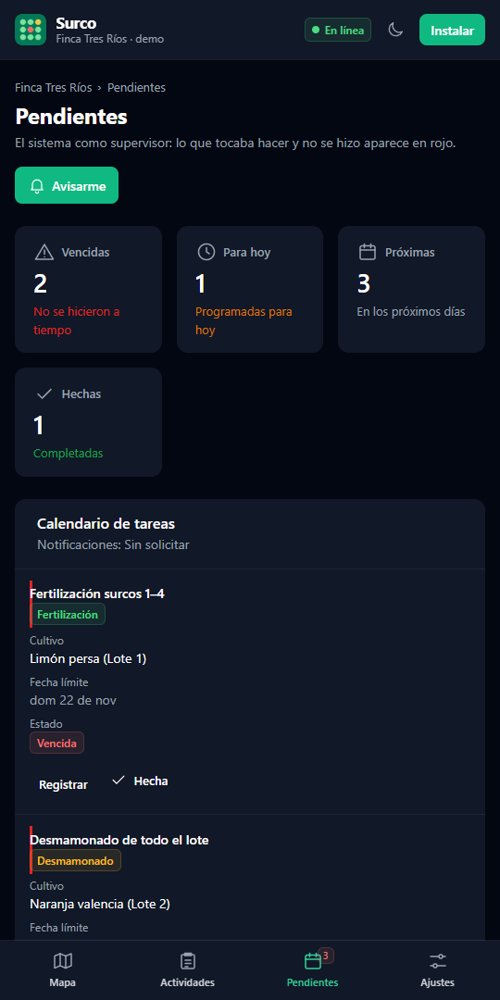
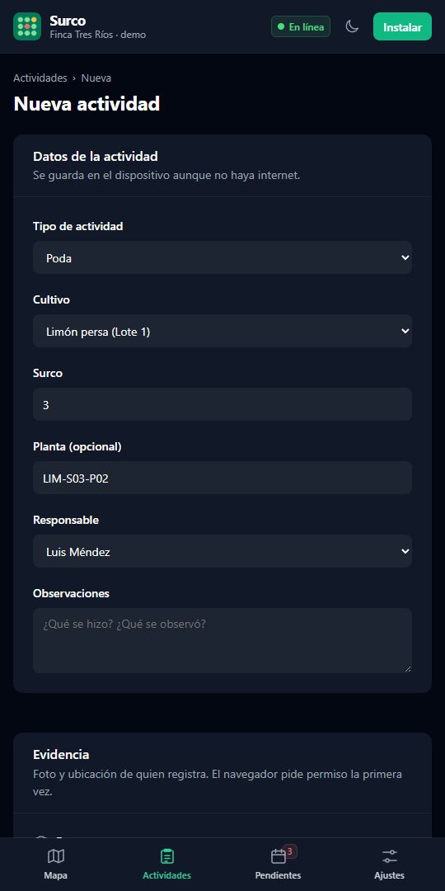
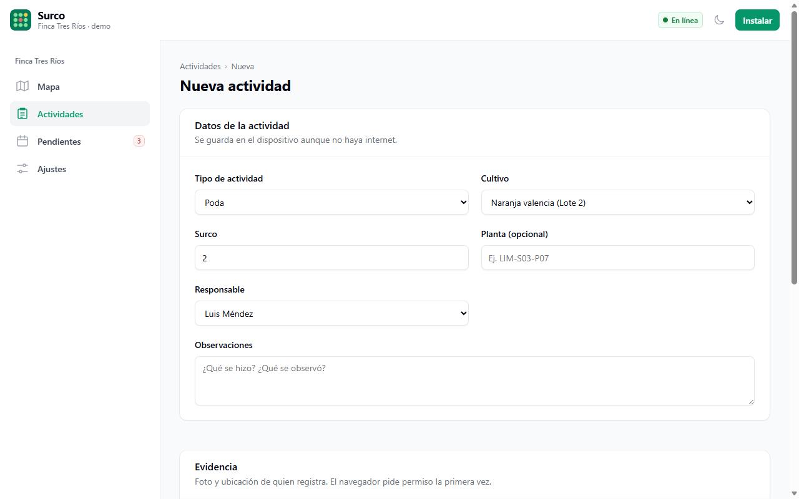
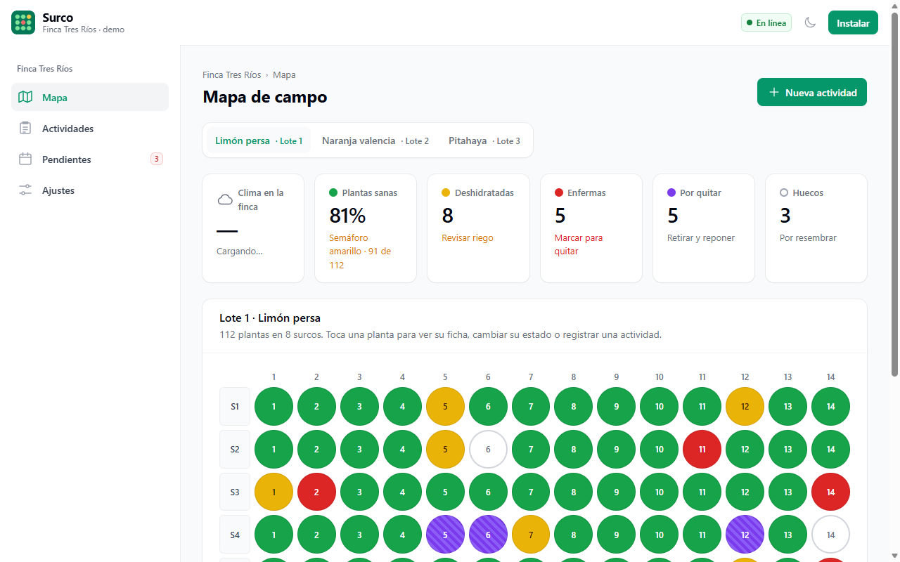
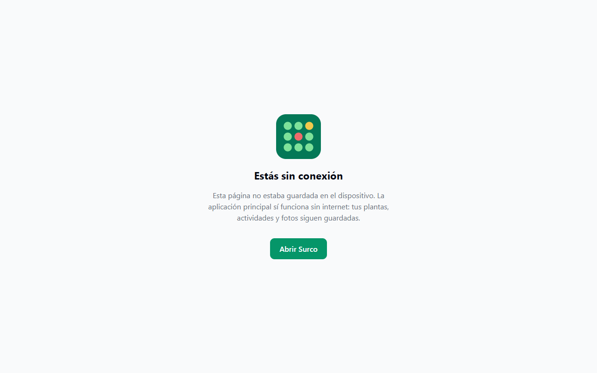

# 🌱 Surco — Mapa de campo (PWA)

Aplicación Web Progresiva para llevar el **mapa electrónico de una finca**: el estado de cada planta (como el semáforo de un mapa en papel), las actividades por surco con **foto y GPS**, y un calendario que **avisa lo que tocaba hacer y no se hizo**. Funciona **sin conexión**.

> 🔗 **Producción:** `https://PENDIENTE.netlify.app` *(sustituir por la URL real)*
> 📦 **Repositorio:** `https://github.com/PENDIENTE/surco-pwa`
> 🧪 Los datos son **ficticios** ("Finca Tres Ríos") y solo sirven para la demostración.

**Materia:** Aplicaciones Web Progresivas · **Docente:** Guillermo Martínez Maza · UTGZ, Ingeniería en Desarrollo y Gestión de Software, sept.–dic. 2026
**Equipo obsi:** Josué Pérez Tapia (Scrum Master) · Ángel de Gabriel Aparicio Maldonado · Andrey Emilio Cabriales Ramírez



---

## 1. Caso de uso

En el campo, el registro se hace en papel y la señal es intermitente. Los mapas impresos de cada cultivo se desactualizan, no hay evidencia de quién hizo cada labor y nadie avisa cuando una tarea se quedó sin hacer.

**Surco** resuelve esto en una tableta o celular:

| Problema | Solución en la app |
|---|---|
| Mapas en papel desactualizados | **Mapa por cultivo**: cuadrícula de surcos y plantas numeradas, con color por estado (buen desarrollo, deshidratada, enferma, por quitar, hueco por resembrar), leyenda y semáforo de % de plantas sanas. |
| "¿Quién hizo qué?" | **Actividades** (poda, fertilización, desmamonado, redondeo, composta, retiro, resiembra) con **responsable, foto 📷 y coordenadas 📍**. |
| Tareas olvidadas | **Pendientes**: lo vencido aparece en rojo y se avisa con **notificaciones 🔔**. Registrar la actividad marca la tarea como hecha. |
| Sin señal en el campo | **Modo offline completo**: Service Worker + IndexedDB. |
| Regla "planta enferma se quita y se repone" | Registrar *Retiro de planta* la deja como **hueco**; registrar *Resiembra* la deja en **buen desarrollo**. |

## 2. Credenciales de prueba

**No requiere usuario ni contraseña.** En **Ajustes › ¿Quién registra?** se elige el perfil demo (Ana Ruiz (técnica), Luis Méndez, Rosa Torres, Pedro Aguilar, Carmen Díaz). Para volver al estado inicial: **Ajustes › Restablecer datos demo**.

## 3. Arquitectura



- **App Shell:** `index.html` contiene solo la parte estática (cabecera, navegación y contenedor `<main>`). Se precarga en la caché y aparece al instante, incluso sin red.
- **Renderizado del lado del cliente (CSR):** cada vista es un módulo JS que lee IndexedDB y pinta el HTML en `<main>`.
- **Responsivo:** en móvil la navegación va abajo; en escritorio (≥ 1024 px) pasa a una barra lateral. El mapa se desplaza horizontalmente en pantallas pequeñas.

### Estructura

```
├── index.html            App Shell
├── offline.html          Página de respaldo sin conexión
├── manifest.json         Web App Manifest
├── sw.js                 Service Worker
├── css/                  base.css (tokens estilo Filament, shell, componentes) · mapa · actividades · pendientes-ajustes
├── js/
│   ├── app.js            Arranque, registro del SW, enrutador, instalación
│   ├── db.js             Capa IndexedDB (CRUD con promesas)
│   ├── apis.js           Cámara, geolocalización, notificaciones, permisos
│   ├── datos-demo.js     Datos ficticios iniciales
│   ├── ui.js             Utilidades de interfaz
│   ├── iconos.js         Íconos de trazo (estilo outline)
│   ├── tema.js           Modo claro / oscuro
│   └── vistas/           mapa.js · actividades.js · pendientes.js · ajustes.js
├── icons/                PNG 32, 96, 180, 192, 512 y maskable
├── screenshots/          Capturas (manifest y README)
├── tools/                Generador de íconos, servidor local y pruebas automáticas
└── docs/plan-trello.md   Planeación del equipo
```

## 4. Manifest (instalabilidad)

| Parámetro | Valor | Para qué sirve |
|---|---|---|
| `name` / `short_name` | Surco — Mapa de campo / Surco | Nombre en la instalación y bajo el ícono. |
| `start_url` / `scope` | `./#/mapa` / `./` | Pantalla con la que abre y qué URLs pertenecen a la app. |
| `display` | `standalone` | Se abre como app, sin barra del navegador. |
| `background_color` | `#f4f1e8` | Color de la **splash screen**. |
| `theme_color` | `#1f5130` | Color de la barra de estado y de la ventana. |
| `icons` | 192 y 512 (`any`) + 192 y 512 (`maskable`) | Ícono de inicio y splash; los *maskable* se adaptan a la forma de cada Android. |
| `screenshots` | 1 *wide* + 2 *narrow* | Diálogo de instalación enriquecido (sin advertencias en DevTools). |
| `shortcuts` | Nueva actividad, Pendientes | Accesos directos al mantener presionado el ícono. |

La app muestra su propio botón **Instalar** usando el evento `beforeinstallprompt`.

## 5. Service Worker y estrategias de caché

| Evento | Qué hace |
|---|---|
| `install` | Precarga los 24 archivos del App Shell en `surco-shell-v1.1.0`. No llama a `skipWaiting()`: la versión nueva espera a que el usuario pulse **Actualizar**. |
| `activate` | **Borra las cachés de versiones anteriores** y toma el control de las pestañas (`clients.claim()`). |
| `fetch` | Elige la estrategia según el recurso (tabla siguiente). |
| `message` | `SKIP_WAITING` activa la versión nueva; `VERSION` responde la versión de caché. |
| `notificationclick` | Abre o enfoca la app en *Pendientes*. |

| Recurso | Estrategia | Por qué |
|---|---|---|
| Navegación a la app (`/`) | **App Shell desde caché** | Abre al instante y sin red. |
| CSS, JS, íconos propios | **Cache-first** (+ caché runtime con límite de 40 entradas) | No cambian entre versiones; la rapidez importa más. |
| Clima (Open-Meteo) | **Network-first** con 4 s de espera máxima y respaldo en `surco-api` | Es un dato que cambia: se prefiere fresco, pero sin red se muestra el último guardado. |
| Página no guardada sin red | `offline.html` | Evita el error nativo del navegador. |

**Para publicar una versión nueva:** cambiar `VERSION` en `sw.js` (por ejemplo `v1.0.1`) y hacer push.

## 6. Persistencia con IndexedDB

Base `surco`, versión 1 (`js/db.js`):

| Store | Llave | Índices | Contenido |
|---|---|---|---|
| `cultivos` | `id` | — | Lote, nombre, nº de surcos y plantas por surco. |
| `plantas` | `id` (p. ej. `LIM-S03-P07`) | `porCultivo`, `porEstado` | Surco, número, **estado** y fecha de actualización. |
| `actividades` | `id` (autoincremental) | `porFecha`, `porPlanta`, `porCultivo` | Tipo, responsable, notas, **foto (Blob JPEG)** y **ubicación** `{lat, lon, precision}`. |
| `tareas` | `id` (autoincremental) | `porFecha` | Título, tipo, cultivo, fecha límite, hecha/hechaEn. |
| `meta` | `clave` | — | Perfil activo, bandera de datos demo y fecha del último aviso. |

Todas las operaciones son **asíncronas** (promesas sobre `IDBRequest`). Cada escritura se confirma al completarse la transacción (`oncomplete`). Funcionan igual con o sin conexión y la interfaz se vuelve a pintar justo después de guardar. **Ajustes** permite pedir almacenamiento persistente (`navigator.storage.persist()`) y exportar un respaldo JSON.

## 7. Web APIs nativas y permisos

| API | Dónde | Manejo de permisos |
|---|---|---|
| 📷 **Cámara** (`getUserMedia`) | Nueva actividad › *Tomar foto* | Se pide al pulsar el botón. Si se niega, no hay cámara o está ocupada, se explica cómo resolverlo. Si el navegador no tiene `getUserMedia`, se usa `<input capture>`. La foto se comprime a JPEG de 1280 px como máximo. |
| 📍 **Geolocalización** | Nueva actividad › *Obtener ubicación* | Si ya estaba concedida, se toma sola. Se distinguen *negado*, *sin señal* y *tiempo agotado*. Si la precisión es baja (> 30 m), se avisa. |
| 🔔 **Notificaciones** | Pendientes › *Avisarme* + aviso automático diario | **Nunca se pide al abrir la app**, solo al pulsar el botón. Se muestran con `registration.showNotification()`, que funciona en Android. |
| Permissions API | Ajustes | Muestra el estado de cada permiso: *Concedido*, *Negado*, *Sin solicitar* o *No soportado*. |

## 8. Ejecutar en local

Requisito: Node.js 18 o superior (no hay dependencias que instalar).

```bash
node tools/servidor-local.mjs        # http://localhost:5173
```

Los Service Workers funcionan en `localhost` sin HTTPS. En un dispositivo real hace falta la URL HTTPS de producción.

### Pruebas automáticas

```bash
node tools/probar-pwa.mjs
```

Abre Microsoft Edge (o Chrome) sin ventana y comprueba 18 puntos:
- App Shell y registro del Service Worker.
- Precache y caché dinámica.
- Manifest e instalabilidad.
- Modo oscuro, cámara (simulada), GPS (simulado) y notificaciones.
- Guardado de la foto y del GPS en IndexedDB.
- **Funcionamiento con el servidor apagado** y consola sin errores.

También regenera las capturas de `screenshots/`. Para regenerar los íconos: `node tools/generar-iconos.mjs`.

## 9. Despliegue (HTTPS)

**Netlify:** *Add new site › Import from Git* › elegir el repo. No hay build y el directorio de publicación es la raíz (ya configurado en `netlify.toml`). Cada push a `main` despliega solo.
**Vercel:** *Add New › Project* › importar el repo › *Framework: Other* › Deploy (`vercel.json` ya incluye las cabeceras).

> ⚠️ Desplieguen siempre **desde GitHub**. No arrastren la carpeta local a Netlify Drop: subiría archivos que no están en el repositorio.

## 10. Capturas

| Móvil: mapa | Móvil: pendientes | Móvil: nueva actividad |
|---|---|---|
|  |  |  |

| Actividad con foto y GPS | Sin servidor: la app sigue funcionando | Página de respaldo offline |
|---|---|---|
|  |  |  |

## 11. Cumplimiento de la rúbrica

| Criterio | Evidencia |
|---|---|
| 1. Manifiesto e instalabilidad | `manifest.json`, íconos 192/512 + maskable, screenshots, botón Instalar. DevTools sin errores de instalabilidad. |
| 2. App Shell y diseño UI | `index.html` estático + vistas CSR. Diseño responsivo para móvil, tableta y escritorio. |
| 3. Ciclo de vida del SW | `install` (precache), `activate` (limpieza de cachés viejas), `fetch` (estrategias) y actualización controlada. |
| 4. Caché y modo offline | Cache-first, network-first y `offline.html`. Probado con el servidor apagado. |
| 5. IndexedDB | 5 stores con índices. Guardado y consulta offline, incluidas las fotos. |
| 6. Web APIs nativas | Cámara, geolocalización y notificaciones, con manejo de permisos. |
| 7. Producción HTTPS | Netlify/Vercel (ver URL arriba). |
| 8. Git | Repositorio público con el historial de commits (pestaña *Commits*). |
| 9. README | Este documento. |
