# Evidencias del sitio publicado

Sitio: https://surcopwa.netlify.app/ · tomadas el 27/11/2026, 8:14:49 p.m. con `node tools/capturas-evidencia.mjs`.

> La cámara y el GPS de las capturas 05–06 son **simulados** por el navegador de prueba. La instalación, la splash screen, los diálogos de permiso nativos y la notificación del sistema se capturan en el celular real.

### 01-movil-mapa.png
Mapa de campo con el estado de cada planta (semáforo) y widgets de estadísticas

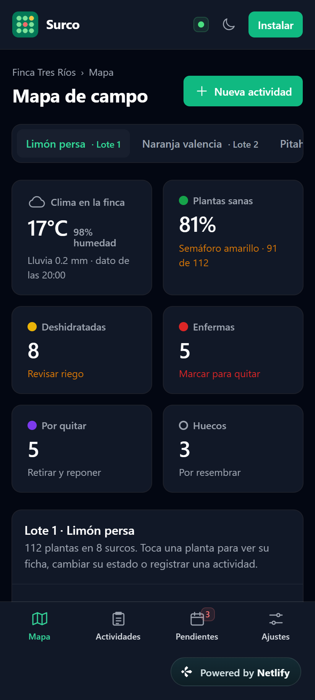

### 02-movil-mapa-cuadricula.png
Cuadrícula de surcos y plantas con su leyenda

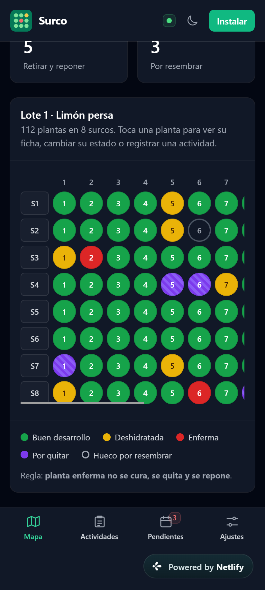

### 03-movil-ficha-planta.png
Ficha de la planta: cambiar estado e historial

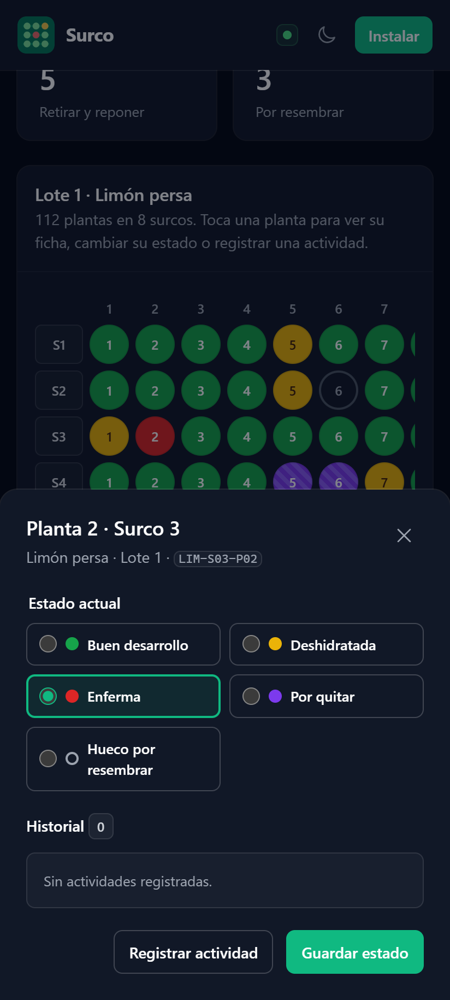

### 04-movil-nueva-actividad.png
Formulario de nueva actividad (se guarda aunque no haya internet)

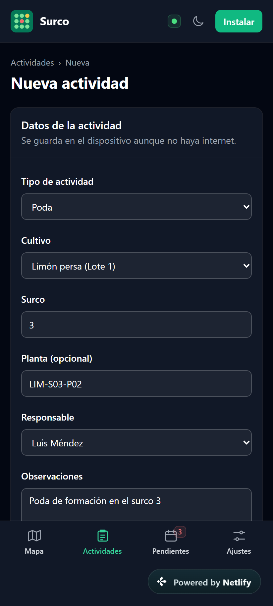

### 05-movil-camara-abierta.png
Web API de cámara abierta (cámara simulada del navegador de prueba)

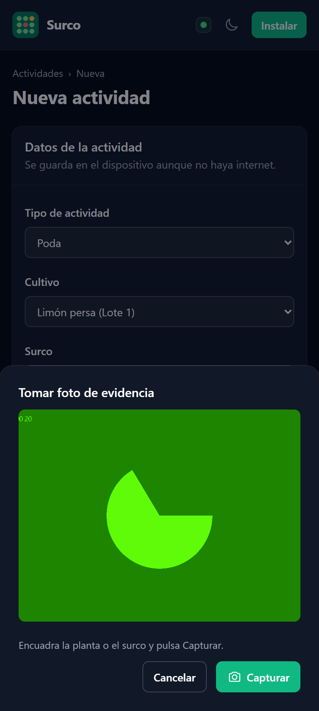

### 06-movil-evidencia-foto-gps.png
Evidencia: foto comprimida y coordenadas GPS con su precisión

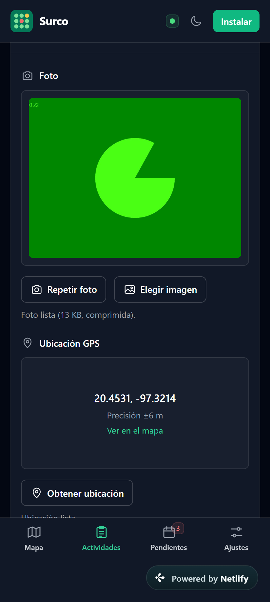

### 07-movil-actividades.png
Registro de actividades con foto, tipo, responsable y GPS (guardado en IndexedDB)

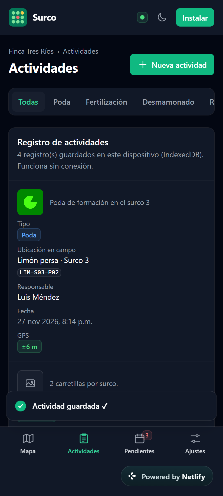

### 08-movil-pendientes.png
Pendientes: tareas vencidas (lo que no se hizo), de hoy y próximas

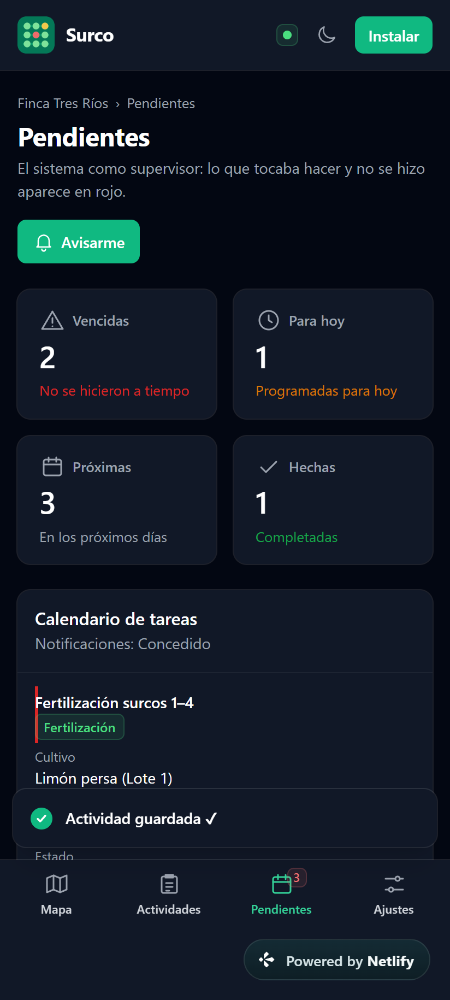

### 09-movil-aviso-enviado.png
Botón "Avisarme": permiso de notificaciones concedido y aviso enviado

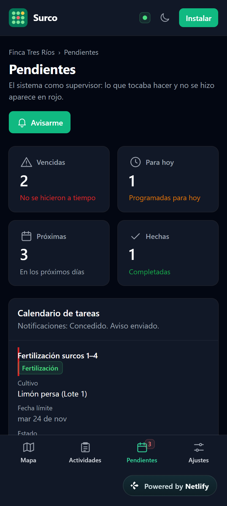

### 10-movil-ajustes-permisos.png
Ajustes: estado de los permisos de cámara, ubicación y notificaciones

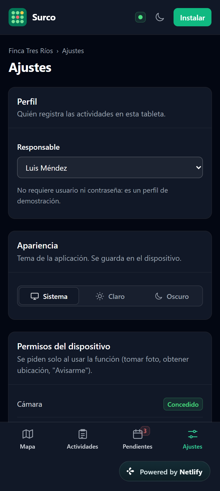

### 11-movil-ajustes-service-worker.png
Service Worker activo y versión de caché publicada

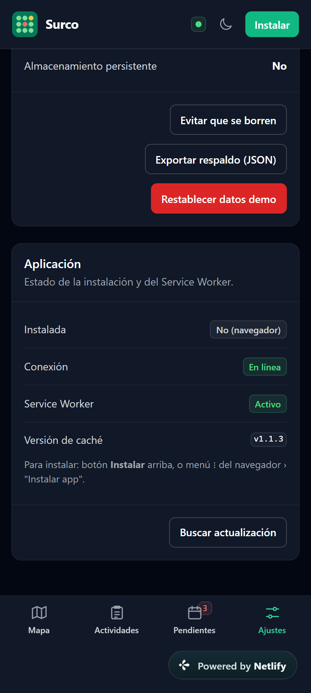

### 12-movil-offline-mapa.png
SIN CONEXIÓN: la app abre desde la caché del Service Worker (indicador en ámbar)

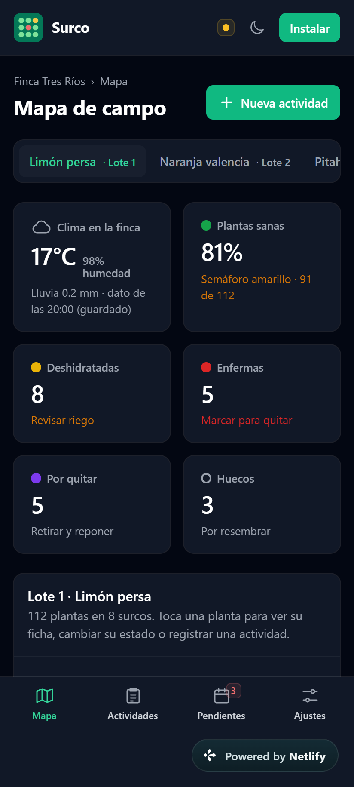

### 13-movil-offline-actividad-guardada.png
SIN CONEXIÓN: actividad guardada en IndexedDB y visible en la lista

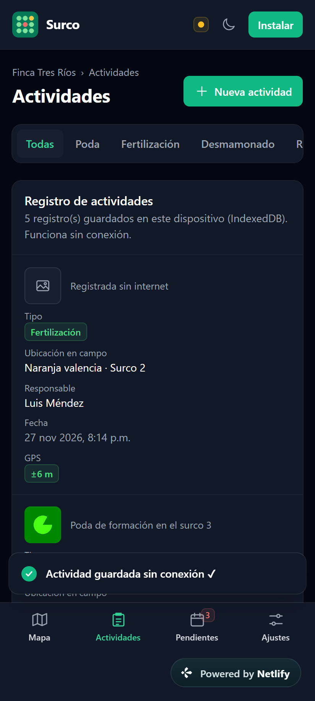

### 14-movil-offline-respaldo.png
SIN CONEXIÓN: página no guardada → página de respaldo offline.html (no el error del navegador)

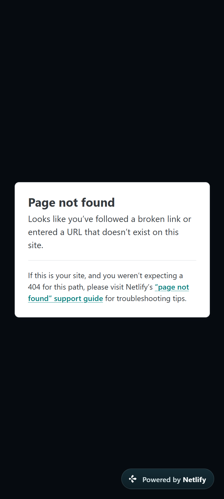

### 15-movil-modo-oscuro.png
Modo oscuro

### 16-escritorio-mapa.png
Escritorio: App Shell con menú lateral y mapa

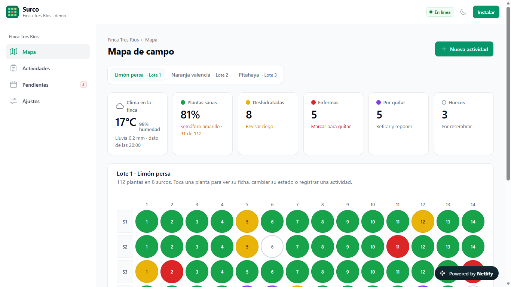

### 17-escritorio-actividades.png
Escritorio: tabla de actividades

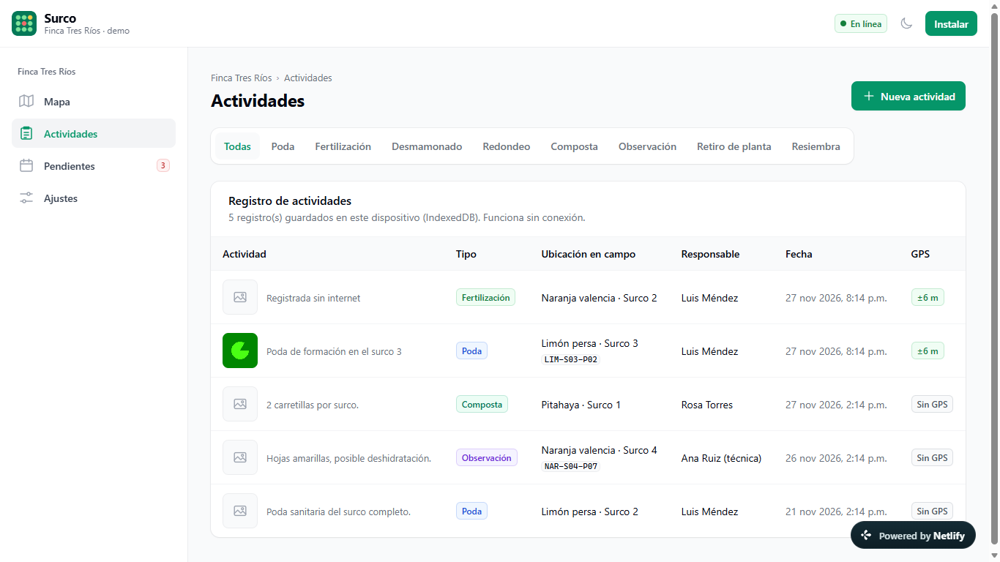

### 18-escritorio-pendientes.png
Escritorio: calendario de pendientes

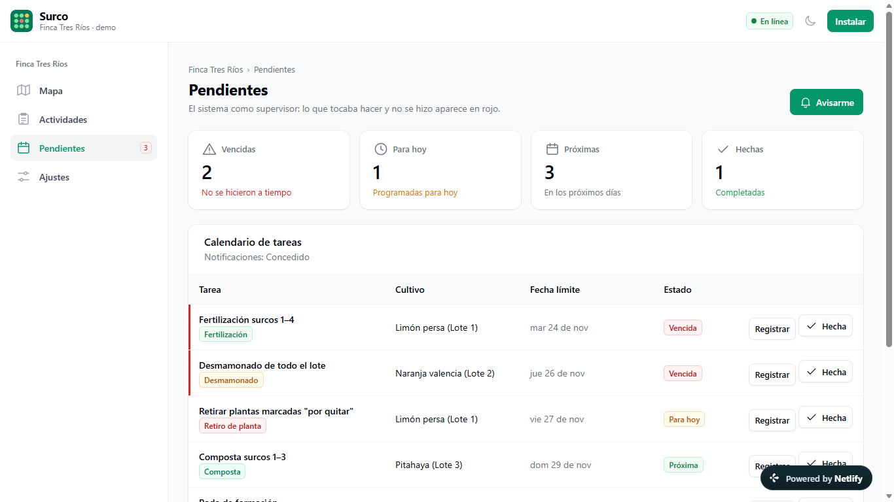
